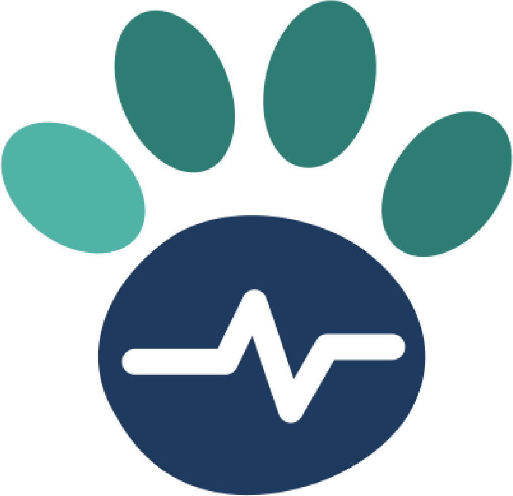
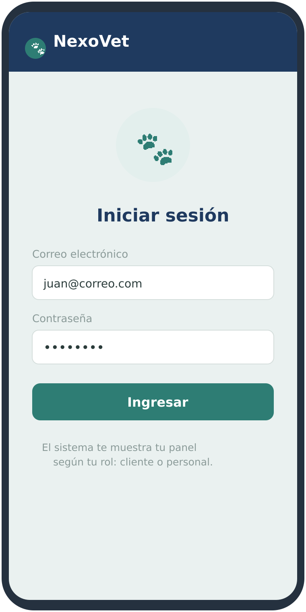
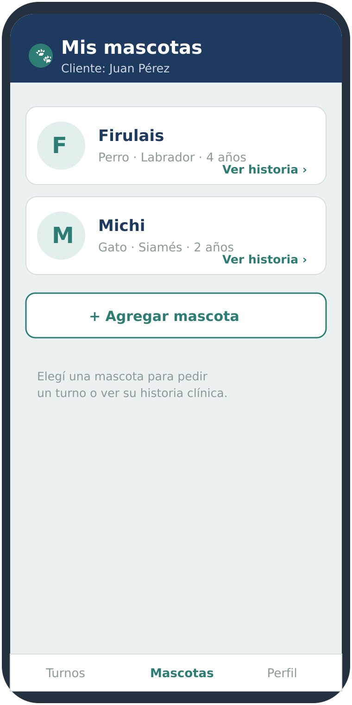
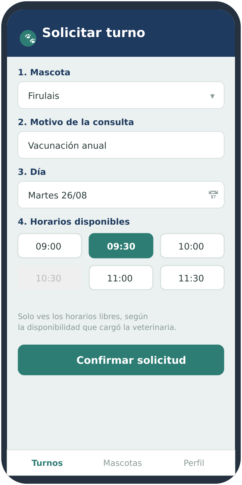
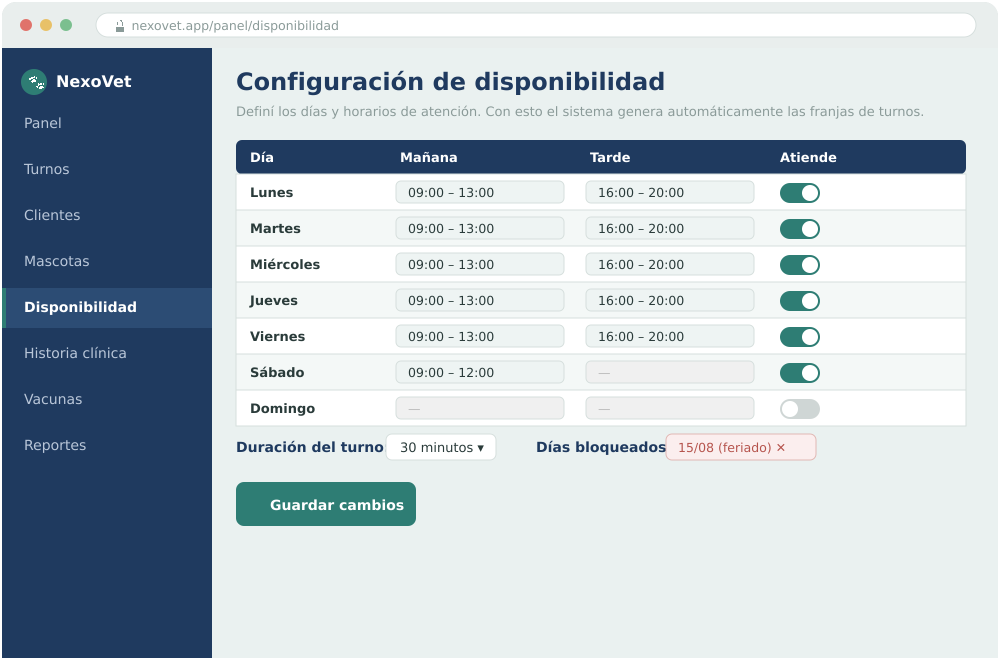
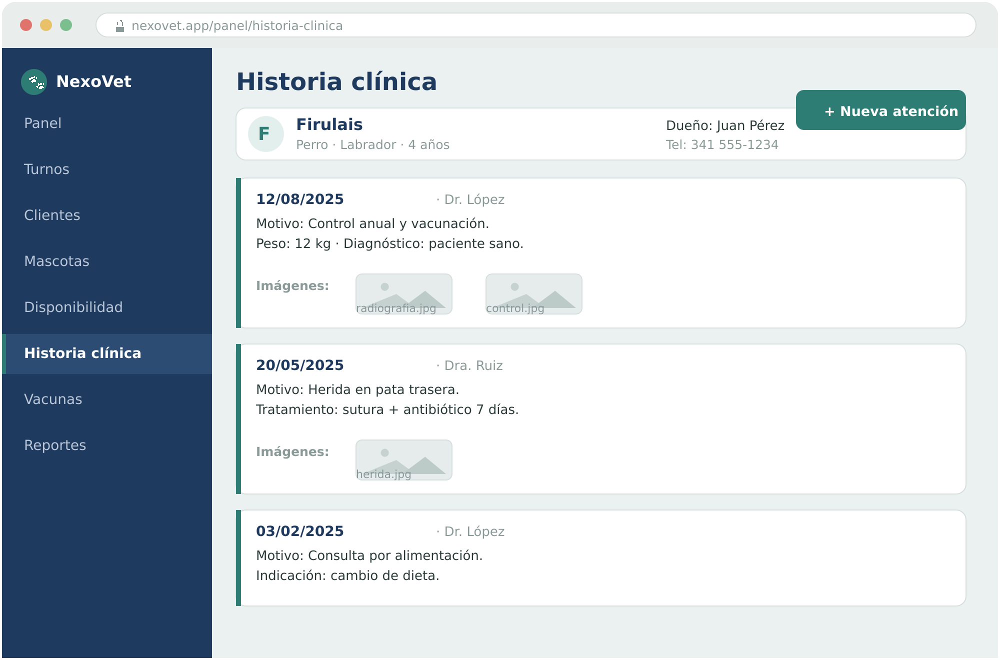

**UNIVERSIDAD TECNOLÓGICA NACIONAL**
Tecnicatura Universitaria en Programación a Distancia (TUPaD)
Trabajo Final Integrador (TFI)

**Propuesta de Proyecto — 1.ª Entrega**

Sistema Integral de Gestión Veterinaria

| | |
|---|---|
| **Integrantes** | Angelelli, Rodrigo Martín Schneider, Astrid Elizabeth |
| **Tutora** | María Candela Grosso |
| **Repositorio GitHub** | <https://github.com/roangelelli/NexoVet> |
| **Fecha de entrega** | 26 / 08 / 2026 |

---

## 1. Definición del problema

Muchas veterinarias de pequeña y mediana escala gestionan su operación diaria de forma manual o con herramientas dispersas: agendas de papel, planillas de cálculo y archivos físicos para las historias clínicas. Esta modalidad genera turnos superpuestos, información difícil de recuperar, historias clínicas incompletas y pérdida de datos ante extravíos o cambios de personal.

Del lado del cliente (el dueño o dueña de la mascota) el problema es igual de concreto: para solicitar un turno debe llamar por teléfono en horario de atención, no tiene forma de consultar el historial médico de su mascota ni de saber cuándo corresponde la próxima vacuna. Toda esa información queda dentro de la veterinaria y resulta inaccesible para quien más la necesita.

Se trata, por lo tanto, de una problemática local y real, presente en cualquier barrio o localidad, con impacto directo en la calidad de atención y en la organización del establecimiento.

## 2. Objetivo del proyecto

### Objetivo general

Desarrollar una aplicación web responsiva que centralice la gestión de una veterinaria y, a la vez, ofrezca a los clientes un canal de autogestión para solicitar turnos y consultar la información médica de sus mascotas.

### Objetivos específicos

- Digitalizar la administración de turnos, clientes, mascotas e historias clínicas.
- Permitir que cada cliente registre y seleccione sus mascotas, contemplando que un mismo cliente puede tener más de una.
- Permitir que el personal configure la disponibilidad de atención, a partir de la cual el sistema genera automáticamente las franjas de turnos.
- Registrar cada atención con diagnóstico, tratamiento, vacunas e imágenes adjuntas (por ejemplo radiografías o fotografías clínicas).
- Ofrecer al cliente una vista propia para solicitar y cancelar turnos, ver la historia clínica de sus mascotas y el carnet de vacunas.
- Exponer una API única, consumida por ambos perfiles de usuario, sobre una misma base de datos.
- Desplegar el sistema en servicios en la nube, accesible desde cualquier navegador, incluido el del teléfono.

## 3. Solución propuesta

Se propone una única aplicación web responsiva construida sobre una arquitectura de tres capas: una interfaz de usuario (frontend), una API que concentra la lógica de negocio (backend) y una base de datos relacional. La misma aplicación presenta experiencias diferenciadas según el rol de quien inicia sesión, distinguiendo entre el personal de la veterinaria y el cliente.

Al ser una webapp responsiva, el cliente accede desde el navegador de su celular a través de una URL, sin necesidad de instalar ninguna aplicación. Esto cubre el requerimiento de acceso móvil sin el costo de desarrollar una aplicación nativa por separado.

## 4. Roles de usuario

El sistema contempla tres roles. Los dos roles del personal comparten toda la gestión operativa; la única diferencia entre ellos es el acceso a la información clínica.

- **Recepción:** gestión operativa del día a día: clientes, mascotas, turnos, horarios de atención y reportes. Puede ver la información clínica, pero no modificarla.
- **Veterinario:** además de toda la gestión operativa, es el único que carga y edita la información clínica (historia clínica y vacunas). Es el rol más completo.
- **Cliente (dueño/a):** autogestión: administra sus mascotas, solicita y cancela sus turnos, y consulta la historia clínica y las vacunas de sus mascotas.

## 5. Alcance y definición del MVP

El MVP se define como el conjunto de funcionalidades indispensables para cumplir el objetivo de punta a punta: que la veterinaria digitalice su gestión y que el cliente pueda autogestionarse. Los módulos se priorizan en tres niveles.

### Núcleo indispensable

Es el flujo mínimo completo: el personal gestiona clientes, mascotas y la disponibilidad de atención; el cliente solicita un turno en una franja libre; Recepción lo confirma; el Veterinario lo atiende y registra la historia clínica de esa atención. Con esto, el objetivo ya se cumple. Incluye los módulos de Usuarios y roles, Clientes, Mascotas, Disponibilidad, Turnos e Historia clínica.

### Módulos secundarios (incluidos en su versión mínima)

Aportan valor pero el sistema funciona sin ellos, por lo que se desarrollan después del núcleo y son los primeros candidatos a recortar si el tiempo es ajustado: Vacunas, Imágenes en la historia clínica y Reportes básicos.

### Fuera del alcance (posibles mejoras futuras)

Se excluyen deliberadamente de esta versión para garantizar la viabilidad en los plazos: pagos en línea, notificaciones y recordatorios automáticos, reprogramación automática de turnos, mensajería o chat interno, asistentes basados en inteligencia artificial, integración con controladores fiscales, disponibilidad por profesional, gestión de cuentas del personal desde la aplicación (en el MVP se cargan manualmente) y el desarrollo de una aplicación móvil nativa.

## 6. Módulos del sistema

Listado de módulos con su nivel de prioridad dentro del MVP:

| Módulo | Prioridad | Descripción |
|---|---|---|
| Usuarios y roles | Núcleo | Inicio de sesión y permisos por rol (Recepción, Veterinario, Cliente). |
| Clientes | Núcleo | Alta, edición y listado de los dueños de las mascotas. |
| Mascotas | Núcleo | Alta, edición y selección; un cliente puede tener varias asociadas. |
| Disponibilidad | Núcleo | Configuración del horario general de atención por parte del personal. |
| Turnos | Núcleo | Ciclo solicitado → confirmado → atendido / cancelado; franjas calculadas según la disponibilidad. |
| Historia clínica | Núcleo | Registro de cada atención vinculada a una mascota. |
| Imágenes en historia clínica | Secundario | Imágenes adjuntas a cada atención (archivo en servicio externo, URL en la base). |
| Vacunas | Secundario | Listado de vacunas por mascota, con fechas de aplicación y renovación. |
| Reportes | Secundario | Consultas de apoyo a la gestión (por ejemplo, turnos del día). |

## 7. Matriz de permisos por rol

La siguiente matriz detalla qué puede hacer cada rol sobre cada módulo. Recepción y Veterinario coinciden en toda la operación; se diferencian únicamente en la carga de la información clínica (historia clínica y vacunas).

| Módulo | Recepción | Veterinario | Cliente |
|---|---|---|---|
| Clientes | Crear / editar | Crear / editar | Registrarse / editar sus datos |
| Mascotas | Crear / editar | Crear / editar | Ver / editar solo las suyas |
| Disponibilidad (horarios) | Configurar | Configurar | — |
| Turnos | Confirmar / cancelar / atender | Confirmar / cancelar / atender | Solicitar y cancelar los suyos |
| Historia clínica | Solo lectura | Crear / editar | Ver (sus mascotas) |
| Imágenes (historia clínica) | Ver | Adjuntar | Ver |
| Vacunas | Ver | Ver / registrar | Ver |
| Reportes | Ver | Ver | — |
| Personal | Solo lectura | Solo lectura | — |

Las cuentas del personal (Recepción y Veterinario) se cargan manualmente durante la puesta en marcha; su gestión desde la aplicación queda como mejora futura.

## 8. Prototipo de interfaz (bocetos)

A continuación se presentan bocetos preliminares de las pantallas principales, elaborados para visualizar cómo se vería el producto. Se trata de representaciones orientativas; el diseño definitivo podrá ajustarse durante el desarrollo.

### Vista del cliente (webapp responsiva en el celular)

| Inicio de sesión (acceso unificado) | Mis mascotas: alta y selección | Solicitud de turno con franjas libres |
|:---:|:---:|:---:|
|  |  |  |

### Vista del personal (panel de gestión web)

*Configuración de disponibilidad: define los horarios que generan las franjas de turno.*

*Historia clínica con imágenes adjuntas a cada atención (radiografías, fotografías).*

## 9. Stack tecnológico

La totalidad del proyecto se desarrolla sobre JavaScript, lo que reduce la complejidad al mantener un mismo lenguaje en todas las capas y facilita su deploy.

| Componente | Tecnología | Justificación |
|---|---|---|
| **Lenguaje** | JavaScript | Único lenguaje de punta a punta; simplifica el desarrollo y la comprensión. |
| **Frontend** | React.js | Interfaz responsiva basada en componentes; se adapta a escritorio y celular. |
| **Backend** | Node.js + Express | API REST que centraliza la lógica de negocio y el acceso a datos. |
| **Base de datos** | MySQL (relacional) | Modelo relacional claro; proveedor de hosting a definir. |
| **Almacenamiento de imágenes** | A confirmar | Servicio dedicado para las imágenes de la historia clínica. |
| **Despliegue / Plataforma** | A confirmar | Servicios en la nube que cumplen el requisito de componentes online. |
| **Control de versiones** | Git + GitHub | Repositorio único donde vive todo el proyecto. |

> **Nota sobre las imágenes:** las imágenes de la historia clínica no se almacenarán dentro de la base de datos, sino en un servicio de almacenamiento externo, guardando en la base únicamente la URL de cada archivo. Esto mantiene la base de datos liviana como práctica recomendada.

## 10. Plan de trabajo y cronograma

El trabajo se organiza siguiendo las instancias de entrega definidas por la cátedra:

| Etapa | Entregable / Actividad | Fecha |
|---|---|---|
| 1.ª Entrega | Propuesta de proyecto, stack tecnológico y declaración del repositorio único de GitHub. | 30/08 |
| 2.ª Entrega | Esquema de la base de datos y listado de módulos aprobados. Otorga la condición de Regular. | 27/09 |
| Desarrollo | Construcción iterativa de los módulos, pruebas y despliegue en la nube. | 28/09 – 13/11 |
| Entrega Final | Repositorio completo, despliegue funcionando, informe escrito y video explicativo (preferentemente en inglés). | 14/11 |
| Defensa Oral | Presentación y justificación del proyecto ante el comité en mesa de examen. | Mesa de examen |

## 11. Repositorio único en GitHub

Todo el proyecto se aloja y desarrolla dentro de un único repositorio de GitHub, que se mantendrá estructurado, limpio y profesional. Su organización inicial prevista es:

- **README.md:** documentación del proyecto, instrucciones de instalación, tecnologías e integrantes.
- **/frontend:** código fuente de la interfaz en React.
- **/backend:** código fuente de la API en Node.js.
- **/database:** scripts DDL/DML, esquema y migraciones.
- **/docs:** informes, esquemas de avance y documentación de las entregas.
