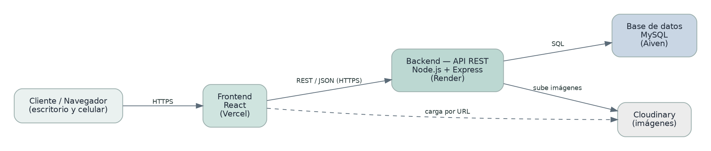

# Arquitectura del Proyecto

**NexoVet — Sistema Integral de Gestión Veterinaria**
Trabajo Final Integrador (TFI) — UTN TUPaD · 2.ª Entrega (Diseño y Módulos)
Integrantes: Angelelli, Rodrigo Martín · Schneider, Astrid Elizabeth | Tutora: María Candela Grosso

---

## Visión general

NexoVet se construye como una aplicación web responsiva sobre una arquitectura cliente-servidor de tres capas: una capa de presentación (frontend), una capa de lógica de negocio expuesta como API REST (backend) y una capa de datos (base de datos relacional). Se apoya, además, en un servicio externo para el almacenamiento de imágenes.



*Diagrama de arquitectura general y despliegue.*

## Patrón de arquitectura

El sistema sigue un patrón cliente-servidor con separación en capas:

- **Capa de presentación (frontend):** una aplicación de página única (SPA) en React que se ejecuta en el navegador y se adapta a escritorio y celular. No accede directamente a la base de datos: todo pasa por la API.
- **Capa de lógica de negocio (backend):** una API REST en Node.js + Express que concentra las reglas del sistema (validaciones, permisos por rol, cálculo de franjas, etc.) y es el único componente que accede a los datos.
- **Capa de datos:** una base de datos relacional MySQL que persiste la información.

Dentro del backend, el código se organiza a su vez en capas, con una separación de responsabilidades cercana al patrón MVC:

- **Rutas:** definen los endpoints de la API.
- **Controladores:** reciben la petición, validan la entrada y arman la respuesta.
- **Servicios:** contienen la lógica de negocio.
- **Acceso a datos (modelos):** ejecutan las consultas a MySQL.
- **Middlewares:** resuelven aspectos transversales como la autenticación y el control de roles.

Esta separación facilita el mantenimiento, permite probar cada parte por separado y hace posible que el equipo trabaje el frontend y el backend en paralelo.

## Tecnologías definidas

El frontend y el backend se desarrollan en JavaScript (la base de datos usa SQL), lo que mantiene un mismo lenguaje de programación en ambas capas de la aplicación y coincide con la especialidad de la tutora.

| Componente | Tecnología | Justificación |
|---|---|---|
| Frontend | React.js — desplegado en Vercel | Interfaz responsiva basada en componentes; Vercel ofrece despliegue continuo desde GitHub. |
| Backend | Node.js + Express — desplegado en Render | API REST en el mismo lenguaje que el frontend; Render permite el despliegue desde GitHub. |
| Base de datos | MySQL — alojada en Aiven | Modelo relacional claro; Aiven brinda MySQL gestionado en la nube. |
| Almacenamiento de imágenes | Cloudinary | Servicio dedicado a imágenes; en la base solo se guarda la URL de cada archivo. |
| Autenticación | JWT (JSON Web Tokens) | Autenticación sin estado, adecuada para una API REST consumida por una SPA. |
| Hash de contraseñas | bcrypt | Las contraseñas se almacenan como hash (no reversible); nunca en texto plano. |
| Control de versiones | Git + GitHub | Repositorio único; base para el despliegue continuo. |

## Comunicación y seguridad

- **Comunicación:** el frontend consume la API mediante peticiones HTTP sobre HTTPS, intercambiando datos en formato JSON (API REST con los verbos GET, POST, PUT y DELETE).
- **Autenticación:** al iniciar sesión, el backend emite un token JWT que el frontend adjunta en cada pedido posterior para identificar al usuario.
- **Autorización:** los permisos por rol se validan siempre en el backend; el frontend adapta la vista, pero la seguridad no depende de él.
- **Contraseñas:** se almacenan como hash con bcrypt (no se cifran, ya que el hash no es reversible); nunca en texto plano.
- **Secretos:** las credenciales de la base de datos, las claves de Cloudinary y el secreto de JWT se guardan en variables de entorno (archivo `.env`), fuera del repositorio.

## Despliegue

Cada componente se publica en un servicio de nube distinto, idealmente con planes gratuitos para un proyecto académico, y se comunican por HTTPS.

| Componente | Servicio | Qué aloja |
|---|---|---|
| Frontend (React) | Vercel | Aplicación web (SPA) servida al navegador del cliente y del personal. |
| Backend (API REST) | Render | API Node.js + Express con toda la lógica de negocio. |
| Base de datos | Aiven (MySQL) | Datos del sistema (usuarios, mascotas, turnos, historia clínica, etc.). |
| Imágenes | Cloudinary | Archivos de las imágenes de la historia clínica (en la base solo se guarda la URL). |

### Publicación

El frontend y el backend se publican automáticamente desde el repositorio de GitHub: cada vez que se actualiza la rama `main`, Vercel y Render construyen y publican la nueva versión. Como el proyecto vive en un único repositorio, a cada servicio se le indica su carpeta raíz (`frontend/` para Vercel y `backend/` para Render).

### Configuración y seguridad

- **Variables de entorno:** las credenciales de la base de datos, las claves de Cloudinary y el secreto de JWT se cargan en cada servicio, fuera del repositorio.
- **HTTPS:** todos los servicios se acceden por conexión cifrada.
- **CORS:** el backend solo acepta pedidos provenientes del dominio del frontend.
- **Base de datos:** la conexión del backend a MySQL se realiza de forma cifrada (SSL/TLS).

## Estructura del repositorio

El proyecto vive en un único repositorio de GitHub, organizado según la arquitectura:

```text
NexoVet/
├── README.md              Documentación del proyecto
├── .gitignore
├── frontend/              Aplicación React (SPA)
│   └── src/               Componentes, vistas y servicios de API
├── backend/               API REST (Node.js + Express)
│   └── src/
│       ├── routes/        Endpoints de la API
│       ├── controllers/   Reciben la petición y responden
│       ├── services/      Lógica de negocio
│       ├── models/        Acceso a datos (MySQL)
│       └── middlewares/   Autenticación, roles y validaciones
├── database/              Scripts SQL
└── docs/                  Diagramas, diseño de BD, arquitectura y módulos
```

## Decisiones técnicas destacadas

- **Frontend y backend en JavaScript:** menor fricción y un mismo lenguaje de programación en ambas capas.
- **Aplicación web responsiva en lugar de app móvil nativa:** cubre el acceso desde el celular sin duplicar el desarrollo.
- **Datos derivados calculados y no almacenados:** franjas de turno y estado de vacunas.
- **Imágenes en servicio externo (Cloudinary):** en la base solo la URL, para mantenerla liviana.
- **Una sola tabla de usuarios** con control de acceso por rol.
