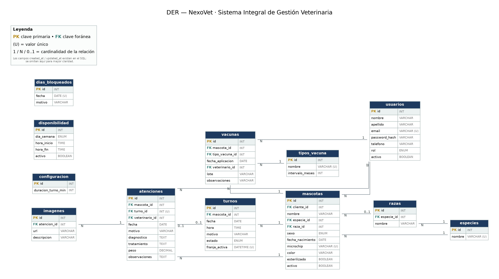

# Diseño de la Base de Datos

**NexoVet — Sistema Integral de Gestión Veterinaria**
Trabajo Final Integrador (TFI) — UTN TUPaD · 2.ª Entrega (Diseño y Módulos)
Integrantes: Angelelli, Rodrigo Martín · Schneider, Astrid Elizabeth | Tutora: María Candela Grosso

---

Este documento describe el diseño de la base de datos de NexoVet: el diagrama entidad-relación, las convenciones adoptadas y el detalle de cada tabla (campos, tipos, claves y relaciones). El motor de base de datos es MySQL (modelo relacional).

## Diagrama entidad-relación

El siguiente diagrama muestra las tablas del sistema, sus campos y las relaciones entre ellas, con la cardinalidad correspondiente (1, N, 0..1).

> **Nota:** los campos `created_at` y `updated_at` (ver convenciones) existen en las tablas transaccionales, pero se omiten del diagrama para mayor claridad.

## Convenciones de diseño

- **Claves primarias:** enteras y autoincrementales (`id`).
- **Contraseñas:** nunca se guardan en texto plano; se almacena su hash en `password_hash` (bcrypt).
- **Baja lógica:** los registros que pueden tener historia asociada (usuarios, mascotas) no se eliminan; se marcan con `activo = FALSE`.
- **Auditoría:** las tablas transaccionales incluyen `created_at` y `updated_at`.
- **Integridad de turnos (sin doble reserva):** una franja admite un único turno. Se garantiza con una validación en el backend y, como última barrera, con una restricción única en la base de datos (ver sección *Turnos*).
- **Datos derivados que no se almacenan:** las franjas de turno libres se calculan a partir de disponibilidad, los turnos ocupados y los días bloqueados; la próxima fecha de una vacuna se calcula como fecha de aplicación + `intervalo_meses` (del tipo de vacuna), y su estado (vigente / por vencer / vencida) se deriva de esa fecha.
- **Imágenes:** los archivos se alojan en un servicio externo (Cloudinary); en la base solo se guarda la URL.

## Modelo de usuarios y agenda general

Se utiliza una sola tabla `usuarios` para los tres roles (Recepción, Veterinario y Cliente), diferenciados por el campo `rol`. Un cliente es, en el fondo, un usuario más que además posee mascotas. Esto unifica la autenticación y evita duplicar la lógica de acceso.

La agenda del MVP es general para la veterinaria y el cliente no selecciona un veterinario al solicitar un turno. El profesional que realiza la atención se registra posteriormente en la historia clínica (`atenciones.veterinario_id`). Por eso la tabla `usuarios` contiene a todos los veterinarios, pero la tabla `turnos` no tiene `veterinario_id`. Como consecuencia, cada franja de la agenda admite un único turno para toda la veterinaria.

## Diccionario de datos

### Catálogos

Los catálogos son tablas de referencia con valores predefinidos que se reutilizan desde otras tablas. Evitan el texto libre y sus inconsistencias (por ejemplo «perro» / «Perro» / «PERRO») y permiten mantener listas controladas y consistentes.

#### especies

Contiene las especies de animales que atiende la veterinaria (Perro, Gato, etc.). Cada mascota referencia una especie, y de ella dependen las razas disponibles.

| Campo | Tipo | Restricciones | Descripción |
|---|---|---|---|
| id | INT | PK, auto | Identificador |
| nombre | VARCHAR(50) | NOT NULL, único | Ej.: Perro, Gato |

#### razas

Lista las razas posibles, cada una asociada a una especie. Al cargar una mascota, se ofrecen únicamente las razas de la especie elegida. La raza es opcional para la mascota.

| Campo | Tipo | Restricciones | Descripción |
|---|---|---|---|
| id | INT | PK, auto | Identificador |
| especie_id | INT | FK → especies, NOT NULL | Especie a la que pertenece |
| nombre | VARCHAR(80) | NOT NULL, único por especie | Ej.: Labrador |

#### tipos_vacuna

Reúne los tipos o nombres de vacunas disponibles (Antirrábica, Quíntuple, etc.). Cada aplicación de vacuna referencia uno de estos tipos, manteniendo unificada la lista y evitando nombres repetidos o mal escritos. Incluye el campo `intervalo_meses`, que indica cada cuántos meses corresponde repetir la vacuna: con él se calcula automáticamente la próxima fecha (si es NULL, la vacuna es de dosis única y no genera próxima fecha).

| Campo | Tipo | Restricciones | Descripción |
|---|---|---|---|
| id | INT | PK, auto | Identificador |
| nombre | VARCHAR(80) | NOT NULL, único | Ej.: Antirrábica |
| intervalo_meses | INT | NULL | Meses hasta la próxima dosis (NULL = dosis única) |

### Usuarios y mascotas

#### usuarios

Tabla central de autenticación e identidad para los tres roles del sistema.

| Campo | Tipo | Restricciones | Descripción |
|---|---|---|---|
| id | INT | PK, auto | Identificador |
| nombre | VARCHAR(80) | NOT NULL | Nombre |
| apellido | VARCHAR(80) | NOT NULL | Apellido |
| email | VARCHAR(150) | NOT NULL, único | Usado para iniciar sesión |
| password_hash | VARCHAR(255) | NOT NULL | Hash de la contraseña (bcrypt) |
| telefono | VARCHAR(30) | — | Teléfono de contacto |
| rol | ENUM | NOT NULL | recepcion / veterinario / cliente |
| activo | BOOLEAN | NOT NULL, def. TRUE | Baja lógica |
| created_at / updated_at | TIMESTAMP | NOT NULL | Auditoría |

#### mascotas

Datos de cada mascota, asociada siempre a un cliente (dueño).

| Campo | Tipo | Restricciones | Descripción |
|---|---|---|---|
| id | INT | PK, auto | Identificador |
| cliente_id | INT | FK → usuarios, NOT NULL | Dueño de la mascota |
| nombre | VARCHAR(80) | NOT NULL | Nombre |
| especie_id | INT | FK → especies, NOT NULL | Especie |
| raza_id | INT | FK → razas, NULL | Raza (opcional) |
| sexo | ENUM | NOT NULL | macho / hembra |
| fecha_nacimiento | DATE | NULL | Fecha de nacimiento |
| microchip | VARCHAR(50) | único, NULL | Nº de microchip |
| color | VARCHAR(50) | NULL | Color / pelaje |
| esterilizado | BOOLEAN | NOT NULL, def. FALSE | Si está esterilizado |
| activo | BOOLEAN | NOT NULL, def. TRUE | Baja lógica |
| created_at / updated_at | TIMESTAMP | NOT NULL | Auditoría |

### Agenda

#### configuracion

Guarda parámetros generales del sistema; en el MVP, la duración de la franja de turno.

| Campo | Tipo | Restricciones | Descripción |
|---|---|---|---|
| id | INT | PK, auto | Identificador |
| duracion_turno_min | INT | NOT NULL, def. 30 | Duración de cada franja, en minutos |

#### disponibilidad

Define los tramos horarios de atención por día de la semana; puede haber varios tramos por día (por ejemplo, mañana y tarde). De aquí se calculan las franjas de turno.

| Campo | Tipo | Restricciones | Descripción |
|---|---|---|---|
| id | INT | PK, auto | Identificador |
| dia_semana | ENUM | NOT NULL | lunes … domingo |
| hora_inicio | TIME | NOT NULL | Inicio del tramo |
| hora_fin | TIME | NOT NULL | Fin del tramo |
| activo | BOOLEAN | NOT NULL, def. TRUE | Si el tramo está vigente |

#### dias_bloqueados

Registra fechas puntuales sin atención (feriados, vacaciones), que se excluyen del cálculo de franjas.

| Campo | Tipo | Restricciones | Descripción |
|---|---|---|---|
| id | INT | PK, auto | Identificador |
| fecha | DATE | NOT NULL, único | Día sin atención |
| motivo | VARCHAR(150) | NULL | Ej.: feriado, vacaciones |

### Turnos

#### turnos

Solicitudes de turno de los clientes, con su ciclo de estados. La agenda es general, por lo que el turno no reserva un veterinario: el profesional que atiende queda registrado en la atención. Cada franja admite un único turno (ver la prevención de doble reserva más abajo).

| Campo | Tipo | Restricciones | Descripción |
|---|---|---|---|
| id | INT | PK, auto | Identificador |
| mascota_id | INT | FK → mascotas, NOT NULL | Mascota del turno (de ella se deriva el dueño) |
| fecha | DATE | NOT NULL | Día del turno |
| hora | TIME | NOT NULL | Hora del turno |
| motivo | VARCHAR(255) | NULL | Motivo de la consulta |
| estado | ENUM | NOT NULL, def. solicitado | solicitado / confirmado / atendido / cancelado |
| franja_activa | DATETIME (generado) | único | Fecha y hora del turno mientras no esté cancelado; NULL si está cancelado |
| created_at / updated_at | TIMESTAMP | NOT NULL | Auditoría |

#### Prevención de doble reserva

Dos clientes pueden consultar al mismo tiempo la misma franja libre y solicitarla casi a la vez. Para que nunca se guarden dos turnos en una misma franja, se combinan dos niveles de protección:

- **Validación en el backend:** antes de crear el turno, la API verifica que la franja pertenezca a la disponibilidad, no caiga en un día bloqueado y no esté ocupada. Si no se cumple, informa al cliente que debe elegir otra.
- **Restricción única en la base de datos (última barrera):** si dos solicitudes llegan prácticamente al mismo tiempo y ambas ven la franja libre, la base impide guardar las dos: se registra la primera y la segunda es rechazada. El backend captura ese rechazo y responde con el mismo aviso.

La restricción única se aplica sobre el campo generado `franja_activa`, que toma el valor de la fecha y la hora mientras el turno no esté cancelado y queda en NULL si está cancelado. De este modo se impiden dos turnos activos en la misma franja, y un turno cancelado libera la franja sin necesidad de borrarlo, conservando el historial.

### Historia clínica

#### atenciones

Cada registro de la historia clínica. Se vincula siempre a la mascota y, opcionalmente, al turno que la originó (si es una urgencia sin turno, queda en NULL).

| Campo | Tipo | Restricciones | Descripción |
|---|---|---|---|
| id | INT | PK, auto | Identificador |
| mascota_id | INT | FK → mascotas, NOT NULL | Mascota atendida |
| turno_id | INT | FK → turnos, NULL, único | Turno que la originó (NULL si es urgencia; un turno origina a lo sumo una atención) |
| veterinario_id | INT | FK → usuarios, NOT NULL | Profesional que atendió |
| fecha | DATE | NOT NULL | Fecha de la atención |
| motivo | VARCHAR(255) | NULL | Motivo |
| diagnostico | TEXT | NULL | Diagnóstico |
| tratamiento | TEXT | NULL | Tratamiento indicado |
| peso | DECIMAL(5,2) | NULL | Peso registrado (kg) |
| observaciones | TEXT | NULL | Notas adicionales |
| created_at / updated_at | TIMESTAMP | NOT NULL | Auditoría |

#### imagenes

Imágenes adjuntas a una atención (radiografías, fotografías). Solo se guarda la URL del archivo, alojado en Cloudinary.

| Campo | Tipo | Restricciones | Descripción |
|---|---|---|---|
| id | INT | PK, auto | Identificador |
| atencion_id | INT | FK → atenciones, NOT NULL | Atención a la que pertenece |
| url | VARCHAR(500) | NOT NULL | URL del archivo (Cloudinary) |
| descripcion | VARCHAR(255) | NULL | Descripción de la imagen |
| created_at | TIMESTAMP | NOT NULL | Auditoría |

### Vacunas

#### vacunas

Historial de vacunas aplicadas por mascota. La próxima fecha no se guarda: se calcula como fecha de aplicación + `intervalo_meses` (del tipo de vacuna). El estado (vigente / por vencer / vencida) se deriva de esa fecha.

| Campo | Tipo | Restricciones | Descripción |
|---|---|---|---|
| id | INT | PK, auto | Identificador |
| mascota_id | INT | FK → mascotas, NOT NULL | Mascota vacunada |
| tipo_vacuna_id | INT | FK → tipos_vacuna, NOT NULL | Tipo de vacuna aplicada |
| fecha_aplicacion | DATE | NOT NULL | Fecha en que se aplicó |
| veterinario_id | INT | FK → usuarios, NOT NULL | Profesional que la aplicó |
| lote | VARCHAR(50) | NULL | Nº de lote (trazabilidad) |
| observaciones | VARCHAR(255) | NULL | Notas |
| created_at / updated_at | TIMESTAMP | NOT NULL | Auditoría |

## Relaciones y cardinalidades

- **usuarios (1) — (N) mascotas:** un cliente puede tener varias mascotas.
- **especies (1) — (N) razas:** cada raza pertenece a una especie.
- **especies (1) — (N) mascotas:** cada mascota tiene una especie.
- **razas (0..1) — (N) mascotas:** la raza de la mascota es opcional.
- **mascotas (1) — (N) turnos:** una mascota puede tener varios turnos.
- **mascotas (1) — (N) atenciones:** una mascota puede tener varias atenciones.
- **turnos (0..1) — (0..1) atenciones:** una atención puede provenir de un turno (o no, si es urgencia), y cada turno origina a lo sumo una atención.
- **usuarios [veterinario] (1) — (N) atenciones:** quién atendió (el turno no registra veterinario, por ser la agenda general).
- **atenciones (1) — (N) imagenes:** una atención puede tener varias imágenes.
- **mascotas (1) — (N) vacunas:** historial de vacunas por mascota.
- **tipos_vacuna (1) — (N) vacunas:** clasifica cada aplicación.
- **usuarios [veterinario] (1) — (N) vacunas:** quién aplicó la vacuna.

Las tablas `configuracion`, `disponibilidad` y `dias_bloqueados` no tienen relaciones directas: son parámetros de la agenda que alimentan el cálculo de las franjas de turno.
